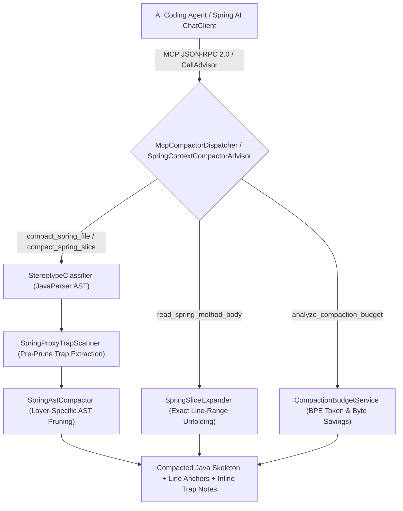

# Spring AI Context Compactor & MCP Server

A reusable **Spring Boot 4.1 starter, Spring AI 2.0 `CallAdvisor`, and MCP server** (`spring-context-compactor-starter`) that performs **Spring-semantic AST compaction** on Java source files, cutting LLM context token consumption by **65% to 85%** while preserving 100% of Spring wiring, JPA mappings, `@Transactional` rules, and inline proxy-bypass warnings.

* **Tech Stack**: **Java 21** (Virtual Threads), **Spring Boot 4.1.x**, **Spring AI 2.0.x**, **JavaParser 3.28.x**, **Spring AMQP (RabbitMQ 3.13)**, **PostgreSQL 16** (Testcontainers), **Hibernate ORM 7.x**.
* **Scope**: Provides both a **Spring AI `CallAdvisor`** (`SpringContextCompactorAdvisor`) that automatically compresses Java code blocks in LLM prompts and deterministic **Model Context Protocol (MCP)** tools (`compact_spring_file`, `compact_spring_slice`, `read_spring_method_body`, `analyze_compaction_budget`) for AI coding agents.

---

## Why This Project Exists

Enterprise **Spring Boot** source files waste thousands of context tokens when fed to LLMs or read by AI coding agents:

1. **Java Boilerplate Overload**: Standard JPA `@Entity` classes, `@Service` orchestrators, and `@RestController` endpoints are padded with getters, setters, `equals`/`hashCode`, builders, import walls, and private helper bodies that consume 70%+ of the file's token budget.
2. **Generic Skeletonizers Strip Spring Semantics**: Naive Tree-sitter or regex minifiers strip annotations, `@Query` JPQL strings, `@Bean` wiring, or hide intra-bean `@Transactional` self-invocation traps buried inside method bodies.
3. **Full-File Reads for 15-Line Edits**: Coding agents routinely read an entire 350-line class just to check injected collaborator types and edit a single method.

**`spring-context-compactor-starter`** solves all three problems with deterministic, Spring-aware AST compaction:

1. **Stereotype-Aware AST Pruning (`SpringAstCompactor`)**: Applies custom compaction rules per Spring stereotype (`@Entity`, `@Service`, `@RestController`, `@Repository`, `@Configuration`, `@RabbitListener`), stripping boilerplate and method bodies while keeping every contract and exact source line range (`/* L42-L88: body omitted (47 lines) */`).
2. **Inline Proxy Trap Preservation (`SpringProxyTrapScanner`)**: Scans method bodies before stripping them so intra-bean `@Transactional` self-invocation (`this.recordInternalComplianceCheck()`) and read-only write leaks are surfaced directly on the compacted method signature with exact line numbers.
3. **Surgical Slice & Method Unfolding (`SpringSliceExpander`)**: Compacts an entire package slice in one call and unfolds only the target `className#methodName` body on demand.
4. **Spring AI `CallAdvisor` (`SpringContextCompactorAdvisor`)**: Plugs directly into Spring AI `ChatClient` pipelines to automatically compact fenced ` ```java ` blocks before LLM invocation.

---

## Architecture Flow



---

## Sample Compacted Spring Skeleton Output

When an AI coding agent or Spring AI advisor compacts `TradeClearingService.java` (240 lines -> 34 lines, **81% token reduction**), it receives a valid, line-anchored Java skeleton with inline proxy-trap diagnostics:

```java
// [SPRING COMPACTOR] File: src/main/java/com/builtbyjuls/clearing/trade/TradeClearingService.java
// Stereotype: SERVICE | Original: 240 lines (~1,980 tokens) -> Compacted: 34 lines (~370 tokens) | Saved: 81.3%
// Injected Beans: [MarginCalculator, ClearedTradeRepository, ClearingMemberRepository, ClearingAuditService, MarginCallPublisher]
package com.builtbyjuls.clearing.trade;

@Service
public class TradeClearingService {
    private final MarginCalculator marginCalculator;
    private final ClearedTradeRepository clearedTradeRepository;
    private final ClearingMemberRepository clearingMemberRepository;
    private final ClearingAuditService clearingAuditService;
    private final MarginCallPublisher marginCallPublisher;

    @Transactional
    public ClearedTrade novateAndClearTrade(TradeSubmissionDto submission)
        /* L58-L114: body omitted (57 lines) | [TRAP: SELF_INVOCATION_BYPASS] calls this.recordInternalComplianceCheck() at L93 */ ;

    @Transactional(propagation = Propagation.REQUIRES_NEW)
    public void recordInternalComplianceCheck(UUID tradeId, String status)
        /* L116-L142: body omitted (27 lines) */ ;

    @Transactional(readOnly = true)
    public Optional<ClearedTrade> findClearedTradeWithAuditCheck(UUID tradeId)
        /* L144-L178: body omitted (35 lines) | [TRAP: READ_ONLY_CALLING_WRITE_REQUIRED] calls this.recordInternalComplianceCheck() at L161 */ ;
}
```

---

## Repository Structure

* **`spring-context-compactor-starter/`**: Reusable **Spring Boot starter, Spring AI `CallAdvisor`, and MCP server** containing `@EnableSpringContextCompactor`, `SpringAstCompactor`, `SpringProxyTrapScanner`, `SpringSliceExpander`, `SpringContextCompactorAdvisor`, and `McpCompactorDispatcher`.
* **`trade-clearing-compactor-demo/`**: Institutional **FX and derivatives trade clearing application** demonstrating Spring-semantic compaction across verbose JPA entities, multi-propagation `@Transactional` services, REST controllers, and RabbitMQ topology.
* **[ARCHITECTURE.md](ARCHITECTURE.md)**: Full **architectural specification**, stereotype pruning matrix, and engineering trade-offs.

---

## Quick Start

### Prerequisites

* **Java 21+** and **Maven 3.9+**
* **Docker** (required for **Testcontainers PostgreSQL 16 & RabbitMQ 3.13**)

### Run the Tests

```bash
# 1. Clone the repository
git clone https://github.com/builtbyjuls/spring-ai-context-compactor.git
cd spring-ai-context-compactor

# 2. Run the Testcontainers suite
./mvnw test
```
